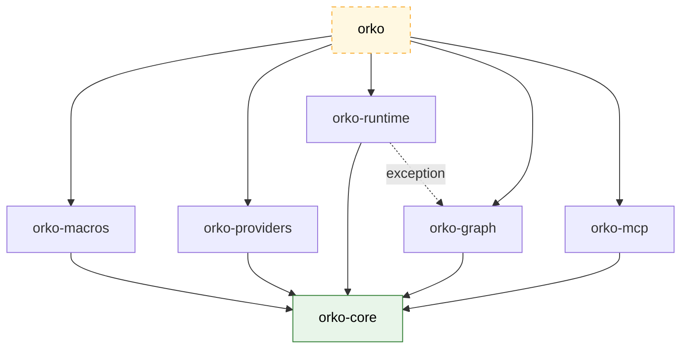

# Orko

> **Agent orchestration toolkit for Rust:** efficient, durable, streaming-first agent orchestration

[](LICENSE)
[](Cargo.toml)
[](#development-status)

```rust
use orko::{create_agent, providers::openai, Result};

async fn run() -> Result<()> {
    let agent = create_agent(openai("gpt-4o-mini")) // key from OPENAI_API_KEY
        .with_system_prompt("You are an agent orchestrated with Orko.")
        .build()?;
    let reply = agent.invoke("Hello!").await?;
    println!("{reply}");
    Ok(())
}
```

## Development status

| Crate                                     | crates.io | Purpose                                                                            |     Status      | Notes                                                                                                                                      |
| ----------------------------------------- | --------- | ---------------------------------------------------------------------------------- | :-------------: | ------------------------------------------------------------------------------------------------------------------------------------------ |
| [`orko-core`](crates/orko-core)           | [](https://crates.io/crates/orko-core) | Core traits & types — `Provider`, `Agent`, `Tool`, `ModelRouter`, streaming chunks |    **alpha**    | API-frozen · 4 unit tests + 1 doctest passing · `clippy -D warnings` clean                                                                 |
| [`orko-macros`](crates/orko-macros)       | [](https://crates.io/crates/orko-macros) | Proc macros (ergonomic tool definitions)                                           |    **alpha**    | `macro@tool` to turn `#[tool]` decorated functions into `Tool`                                                                             |
| [`orko-providers`](crates/orko-providers) | [](https://crates.io/crates/orko-providers) | Provider implementations (OpenAI-compatible HTTP + SSE, local inference)           |    **alpha**    | Codec/transport split, hyper + rustls `TokioTransport` (swappable) · 17 OpenAI-compatible presets, `from_str("provider:model")` · 15 tests |
| [`orko-graph`](crates/orko-graph)         | not published | Graph-based multi-agent workflows                                                  |  🩻 Scaffolded  | Empty stub, not published in 0.1.0                                                                                                         |
| [`orko-runtime`](crates/orko-runtime)     | not published | Tokio runtime integration & task spawning                                          |  🩻 Scaffolded  | Empty stub, not published in 0.1.0; the _only_ crate allowed to touch tokio                                                                                       |
| [`orko-mcp`](crates/orko-mcp)             | not published | Model Context Protocol integration                                                 |  🩻 Scaffolded  | Empty stub, not published in 0.1.0                                                                                                         |
| `orko` (facade)                           | [](https://crates.io/crates/orko) | Single-dependency entry point re-exporting the workspace                           |    **alpha**    | Re-exports core, `#[tool]` (`macros`) and `providers`                                                                                                        |

### Providers status

Every provider is tracked as an issue under the
[`crate: providers`](https://github.com/orko-rs/orko/labels/crate%3A%20providers) label.
The OpenAI-compatible engine
([#3](https://github.com/orko-rs/orko/issues/3)) is the base, everything marked _preset_ is a thin configuration over it,
while _codec_ rows implement a new wire format sharing the same transport.

| Provider     | Kind                    | Env key                |                  Tracking issue                  |   Status    |
| ------------ | ----------------------- | ---------------------- | :----------------------------------------------: | :---------: |
| OpenAI       | engine + preset         | `OPENAI_API_KEY`       |  [#3](https://github.com/orko-rs/orko/issues/3)  |  **alpha**  |
| Anthropic    | native codec            | `ANTHROPIC_API_KEY`    |  [#6](https://github.com/orko-rs/orko/issues/6)  | **planned** |
| Azure OpenAI | codec variant           | `AZURE_OPENAI_API_KEY` | [#22](https://github.com/orko-rs/orko/issues/22) | **planned** |
| AWS Bedrock  | native codec + SigV4    | AWS credential chain   | [#23](https://github.com/orko-rs/orko/issues/23) | **planned** |
| Google       | preset                  | `GEMINI_API_KEY`       |  [#4](https://github.com/orko-rs/orko/issues/4)  |  **alpha**  |
| DeepSeek     | preset                  | `DEEPSEEK_API_KEY`     |  [#5](https://github.com/orko-rs/orko/issues/5)  |  **alpha**  |
| Groq         | preset                  | `GROQ_API_KEY`         |  [#7](https://github.com/orko-rs/orko/issues/7)  |  **alpha**  |
| Together     | preset                  | `TOGETHER_API_KEY`     |  [#8](https://github.com/orko-rs/orko/issues/8)  |  **alpha**  |
| OpenRouter   | preset                  | `OPENROUTER_API_KEY`   |  [#9](https://github.com/orko-rs/orko/issues/9)  |  **alpha**  |
| Moonshot     | preset                  | `MOONSHOT_API_KEY`     | [#10](https://github.com/orko-rs/orko/issues/10) |  **alpha**  |
| Qwen         | preset                  | `DASHSCOPE_API_KEY`    | [#11](https://github.com/orko-rs/orko/issues/11) |  **alpha**  |
| Mistral      | preset                  | `MISTRAL_API_KEY`      | [#16](https://github.com/orko-rs/orko/issues/16) |  **alpha**  |
| xAI          | preset                  | `XAI_API_KEY`          | [#17](https://github.com/orko-rs/orko/issues/17) |  **alpha**  |
| Perplexity   | preset                  | `PERPLEXITY_API_KEY`   | [#18](https://github.com/orko-rs/orko/issues/18) |  **alpha**  |
| NVIDIA NIM   | preset                  | `NVIDIA_API_KEY`¹      | [#19](https://github.com/orko-rs/orko/issues/19) |  **alpha**  |
| Z.ai (GLM)   | preset                  | `ZAI_API_KEY`          | [#20](https://github.com/orko-rs/orko/issues/20) |  **alpha**  |
| HF router    | preset                  | `HF_TOKEN`             | [#21](https://github.com/orko-rs/orko/issues/21) |  **alpha**  |
| Ollama       | preset (local, no auth) | —                      | [#12](https://github.com/orko-rs/orko/issues/12) |  **alpha**  |
| vLLM         | preset (local)          | `VLLM_API_KEY`¹        | [#13](https://github.com/orko-rs/orko/issues/13) |  **alpha**  |
| llama.cpp    | preset (local)          | `LLAMACPP_API_KEY`¹    | [#14](https://github.com/orko-rs/orko/issues/14) |  **alpha**  |
| Candle       | in-process (no HTTP)    | `HF_TOKEN`¹            | [#15](https://github.com/orko-rs/orko/issues/15) | **planned** |

¹ optional: only sent when the server enforces auth (Candle: only for gated Hub repos).

## Architecture



Arrows mean "depends on": everything points down at `orko-core`, the facade (orko)
points at everything, and the one dotted edge is the single allowed extra
dependency (`orko-runtime` → `orko-graph`).

The rules that keep it honest:

1. **Dependencies flow down:** every crate depends only on `orko-core`
   (exception: `orko-runtime` may also depend on `orko-graph`).
2. **No tokio in public APIs:** public traits use `std::future::Future` and
   `futures::Stream` only. Tokio appears only in `orko-runtime` and in the
   built-in HTTP transport of `orko-providers` (`transport-tokio`, swappable
   through the `Transport` trait).
3. **`orko-core` stays lean:** exactly four dependencies (`serde`,
   `serde_json`, `thiserror`, `futures`), no HTTP, no runtime, `#![forbid(unsafe_code)]`.

## Getting started

```sh
git clone https://github.com/orko-rs/orko
cd orko
cargo test --workspace
cargo clippy --workspace --all-targets --all-features -- -D warnings

# offline stub unless OPENAI_API_KEY / DEEPSEEK_API_KEY is set
cargo run --example hello_openai
cargo run --example hello_deepseek
```

## License

Licensed under the [Apache License, Version 2.0](LICENSE).
